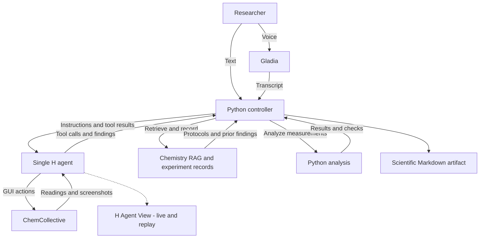

# Jesse

Status: planning draft. Record agreed decisions here; resolve the open choices and obtain the user's final shared-understanding confirmation before implementation.

## Product

Jesse is an autonomous research technician for software-based experimental investigations. One H agent selects a protocol, operates ChemCollective, analyzes measurements, investigates discrepancies, and produces a traceable scientific Markdown report.

An unknown experiment is an unknown sample or unanswered question within supported protocols and simulations. The agent may adapt measurements and move between supported activities. Findings describe the configured simulator and its assumptions.

First demonstration: characterize Compound Y's specific heat capacity in the coolant activity and compare it with the supplied reference. Use liquid-density identification as the earlier interaction feasibility exercise.

Retain five stories: Result Detective, Protocol Reproducer, Hands-Free Technician, Adaptive Experimenter, and Experiment Handoff. Prioritize Result Detective.

## Python and H responsibilities

Q10 accepted for the MVP: one H agent with a lightweight Python controller. Revisit this boundary only when a concrete requirement justifies a change.

Use one H reasoning and computer-use agent. A lightweight Python controller manages sessions, executes custom tools, validates records, persists state, and enforces budgets. H chooses GUI actions and follow-up experiments. The H SDK provides the session/tool-call loop; an additional orchestration framework is not required for the MVP.

Expose tools for retrieving protocols and previous findings, recording observations, writing contextual knowledge, running predefined analyses, and assembling reports. Retrieval and analysis are tools rather than additional agents.

Operate ChemCollective through its interface. Associate observed readings with settings, units and supporting screenshots or session events. Preserve raw measurements separately from derived results.

Use hosted H sessions and retain agent_view_url for live viewing and replay in H Agent View. Keep one backend executor for custom tools; additional observers remain read-only. The backend must remain running while tool execution is needed.

Gladia supplies voice transcription. Spoken responses require a separate speech-output implementation. Devin and Linkup are outside the MVP.

## Architecture

## RAG and persistent knowledge

Keep three distinguishable record classes:
- Reference: curated protocols, assumptions, equations, units and reference properties, with source location and version.
- Observation: immutable run-specific readings, settings, units and evidence references.
- Interpretation: hypotheses, failures and conclusions, with verification status and links to supporting or contradictory observations.

Retrieve relevant reference material and earlier investigations during planning and diagnostic decisions. Check whether the sample, conditions and simulator match before reusing a previous finding.

Record observations during execution and contextual findings after analysis. Use stable run and step identifiers so retried tool calls do not duplicate records. Keep failed and inconclusive investigations retrievable.

Generated findings retain their provenance and status. Repeated retrieval does not promote a conclusion into an established reference fact. Corrections produce derived records while preserving original observations.

Backfill a small approved chemistry corpus for supported activities. Sponsor setup PDFs are integration documentation rather than chemistry knowledge. Keep credentials outside indexes and artifacts. Source selection, refresh rules and promotion of findings remain open decisions.

## Autonomy and completion

Start each investigation with an evidence checklist and execution budget. Permit measurement repeats, configuration checks and adaptations within that budget.

Return one of three outcomes: supported conclusion, inconclusive, or blocked. Completion requires protocol-specific observations, checked units and conditions, and a verification measurement or repeat where required.

Budget exhaustion produces an inconclusive report with recorded progress. An unresolved ambiguity or unavailable required action produces a blocked result and a specific request. Ask before expanding the agreed scope or budget.

Calibrate numerical limits after the interaction feasibility exercise and settle them before implementing the full autonomous loop.

## Personality and artifacts

Conversation: a calm, concise lab colleague. Announce the next meaningful action, report material findings, and state uncertainty directly. Example: “The estimates disagree. I will check the experimental conditions before repeating the measurement.”

Reports: precise scientific language separating method, observations, analysis, interpretation and limitations.

Produce one primary Markdown artifact per investigation, with KaTeX-compatible mathematics, tables, citations and simple Mermaid TD/LR diagrams where useful. Store supporting data, plots and analysis artifacts alongside it and link the evidence. PDF and XLSX output are outside the current MVP.

The report includes the question, protocol, assumptions, observations, analysis, verification, conclusion, limitations and evidence links. Inconclusive investigations still produce reports.

Working language and speech-output approach remain open decisions.

## Construction sequence

1. Settle scope and evidence criteria. Done when the user confirms the scientific scenario, knowledge policy, interaction surface and remaining design choices.
2. Prove H interaction. Run the density exercise and inspect coolant thermal controls. Done when an actual H session manipulates the required controls, captures readings and evidence, and exposes Agent View. Manually opening the lab is not this proof.
3. Establish records and backfill. Done when the approved corpus is ingested, citations resolve, and retrieval distinguishes references from earlier run conclusions.
4. Build a vertical experiment. Done when observed measurements reach a predefined Python analyzer and its results drive one documented follow-up measurement.
5. Add persistent learning and recovery. Done when a later investigation retrieves an earlier run, responds to one deliberate discrepancy, and preserves provenance and original measurements.
6. Add voice. Done when a spoken correction changes the active investigation and the selected speech output gives a brief update.
7. Produce the artifact and demo. Done when Markdown math and diagrams render in the chosen viewing surface, evidence links resolve, and supported, inconclusive and blocked outcomes have been exercised.

## Domain code: vertical slices

Organize domain code around use cases, such as retrieving a protocol, recording an observation, analyzing measurements, or producing a report. Co-locate each slice's application logic, domain rules, input/output contracts, and relevant tests. Keep provider and persistence integrations behind narrow interfaces; share infrastructure only when multiple slices actually need it.

Build each slice end to end through its entry point, domain behavior, required integrations, persistence, and observable result before expanding to another use case. A slice is complete when its acceptance criteria are demonstrated through the real application path. Prefer a small working scientific workflow over completing horizontal technical layers separately.

## Agent working instructions

Fetch current API documentation before library or service integration. Use Context7 resolution and queries when relevant documentation is indexed; otherwise consult official documentation.

Use this file as the canonical project decision record, including its architecture diagram. AGENTS.md is the entry-point pointer to this document.

## Open decisions

- Approve the initial chemistry sources and reference refresh or promotion rules.
- Confirm a thin interaction interface with H Agent View as the execution viewer.
- Choose working language and speech-output implementation.
- Calibrate numerical run budgets after the feasibility exercise.
- Confirm shared understanding before implementation.

## Resources

PDF documentation is stored in docs/resources/. Coupon and credit-benefit handouts are excluded.

- Coolant activity: https://chemcollective.org/vlab/92
- Density activity: https://chemcollective.org/activities/vlab/69
- H custom tools: https://hub.hcompany.ai/agents-api/custom-tools
- H Agent View: https://hub.hcompany.ai/agents-api/observe-and-steer
- H setup: [getting-started guide](<docs/resources/H Company - Get Started with Agents API.pdf>)
- H references: [technical resources](docs/resources/H_Company_Agents_API_Technical_Documentation.pdf)
- Gladia references: [technical resources](docs/resources/Resources_Gladia_Technical_Documentation.pdf)
- Linkup references, outside the current MVP: [technical resources](docs/resources/Resources_Linkup_Technical_Documentation.pdf)
