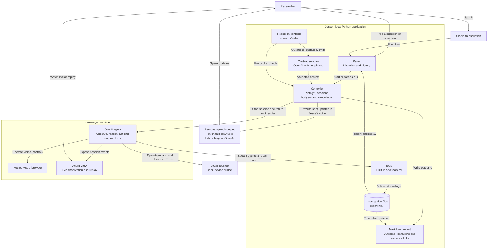

# Jesse

Status: research contexts are implemented. Each lab is a folder under `contexts/` (context.toml, protocol.md, optional tools.py) loaded at runtime; the panel can pin one with `jesse-ui --context <id>` and choose its surface with `--surface`. Shipped contexts are experimental ChemCollective coolant (web) and NetLogo Fire (desktop/web). The user approved Fire on 2026-11-07 as a new context using the generic runner. Fire interaction proofs remain pending on both surfaces; the earlier replay-verified NetLogo Enzyme Kinetics proof (run 20261107T133143442966Z) does not verify Fire. Coolant live acceptance, replay review and an analysis-driven follow-up remain open.

Team constraints: three people, 24 hours until submission as of planning, with work expected to start in 8–10 hours. Plan around eight focused implementation hours.

For team task allocation and milestone handoffs, read [the hackathon work plan](docs/HACKATHON_PLAN.md) and its proposed contracts. For each lab, maintain its context folder under `contexts/` and the [shared agent behavior](src/jesse/instructions.md); the controller loads both into H's prompt. Later gates and optional multi-provider review in the work plan remain proposals; the accepted single-agent MVP still applies. This file is the canonical decision record.

## Product

Jesse is an autonomous research technician for software-based experimental investigations. A research planner selects a suitable protocol and surface from an approved catalogue. An H computer-use agent executes the experiment through its interface. The target workflow analyzes measurements, investigates discrepancies and produces a traceable scientific Markdown report.

An unknown experiment is an unknown sample or unanswered question within supported protocols and simulations. The agent may adapt measurements and move between supported activities. Findings describe the configured simulator and its assumptions.

## Demo scenarios

The first context is the ChemCollective engine coolant activity (`contexts/chemcollective-coolant`). Demo prompt: “Compare this new coolant with the reference, run the experiment, verify your measurements, and explain which absorbs more heat per gram for the same temperature rise.” Record volumes, temperatures, thermal assumptions and a repeat; calculate specific heat capacity and compare it with the supplied reference. The reference is a supplied constant, not a GUI trial.

The second context is NetLogo Fire (`contexts/netlogo-fire`). Demo prompt: “How does tree density change how much of a forest burns? Compare 55% and 70% density and repeat both conditions.” Four fresh GUI trials compare displayed percent burned with unchanged world geometry; ticks are model steps. The context supplies the operating protocol, checked descriptive analysis and repeat comparison. Both desktop and web use the existing runner. Each surface needs its own interaction proof. Four trials cannot estimate a critical density, a crossing probability or real wildfire risk.

Additional labs are added as context folders. Each remains unverified until H demonstrates its required GUI interactions. Choose tools by scientific fit; do not force unrelated simulators into one experimental chain. Findings concern the simulator, not a physical laboratory validation.

Sources: https://chemcollective.org/activities/info/92 ; https://chemcollective.org/vlabs ; https://ccl.northwestern.edu/netlogo/models/Fire

Retain five stories: Result Detective, Protocol Reproducer, Hands-Free Technician, Adaptive Experimenter, and Experiment Handoff. Prioritize Result Detective.

## Python and H responsibilities

Q10 evolved with the user's question-routing requirement: retain one H computer-use operator and the lightweight Python controller, and add a replaceable catalogue-selection step before execution. The default selector uses PydanticAI with OpenAI; an explicit H tool-only selector is available through `--planner h`. These are alternative backends, not simultaneous planners. The full autonomous research-manager loop remains future work.

The selector returns a typed proposal; Python checks the registered protocol, actual surface availability and the researcher's explicit surface preference before launching H. The model cannot choose an arbitrary executor or expand the selected context's trial limit (coolant: two; Fire: four). The controller manages sessions, executes custom tools, validates records, persists state and enforces a shared selection/execution budget. H chooses GUI actions. H's runtime manages the observation, model, action and tool loop; the SDK executes custom tools in our application while processing the session.

Expose tools for inspecting the approved application catalogue, recording observations, running predefined analyses, and assembling reports. Supply bounded protocols and assumptions directly in the investigation context. RAG, vector search, corpus backfill and retrieval of earlier investigations are outside the product scope.

Operate the selected approved simulator through its browser or native desktop interface. Associate observed readings with settings, units and supporting screenshots or session events. Preserve raw measurements separately from derived results.

Use hosted H sessions and retain agent_view_url for live viewing and replay in H Agent View. Keep one backend executor for custom tools; additional observers remain read-only. The backend must remain running while tool execution is needed.

Gladia supplies voice transcription. The voice workflow groups final utterances into researcher turns. Its optional preparation mode previews PydanticAI-enriched requests; plan-only mode uses the catalogue selector. The user also authorized a separate general-browser `--run` mode: each turn is enriched and submitted to one interactive H session without catalogue selection. This is not an approved experimental protocol, does not expose validated observation or analysis tools, and its scientific output remains unverified. Browser behavior restrictions are instructions rather than an enforced access policy. It does not steer an active catalogue investigation. The panel implements speech output separately; the general-browser CLI does not play spoken responses. Devin and Linkup are outside the MVP.

## H harness and extension boundaries

H's harness is the runtime that connects screen observations, model decisions, GUI actions and tool results. Holo is the model used by that runtime. Public documentation describes H's own runtime; it does not identify a third-party orchestration framework underlying the hosted service.

For the MVP, use the managed Agents API and its extension points: agent instructions, model selection, reasoning effort, skills, custom Python tools, browser or desktop environments, and structured output schemas. We configure this runtime rather than patch its hosted internals. Implement Jesse's experimental behavior through instructions, application selection, observation recording, analysis and report tools.

Local execution is a separate option. Client.local() runs H's supplied runtime on our machine and can use a hosted or self-hosted Holo model. Running a downloaded runtime locally does not establish that its internals are available to edit. Local mode has different capabilities from hosted sessions; verify observability and required features before changing execution mode.

For complete control of the loop, the Models API supports implementing our own observation handling, action execution, tool dispatch, memory management, retries and stopping rules. Consider this only after documenting a requirement that the managed extension points cannot satisfy.

The public HoloDesktop CLI repository now installs the CLI distributed with the hai-agents SDK. Its open-source license is not evidence that the entire hosted harness is open source. Treat client code, runtime implementation and model weights as distinct layers with their own capabilities and licenses.

## Architecture

Jesse has one local Python controller, a replaceable context selector and one hosted H computer-use operator. Python owns contexts, session lifecycle, budgets, tools, validated records and artifacts; H owns GUI actions. The selector uses OpenAI through PydanticAI or a separate H tool-only planning session, or is skipped when a context is pinned. Gladia supplies voice input in the panel. Web and desktop are alternative execution surfaces declared per context.

Solid connections show implemented paths; dashed connections show planned capabilities.

Extensibility lives in context folders. A new lab on an existing surface needs only a folder; it still needs its own interaction proof before its status changes from unverified.

The scientific loop is plan → measure → analyze → verify or adapt → report. Outputs may be supported, inconclusive or blocked. A context may let Python conclude `supported_conclusion` once its completion criteria are met (coolant: two checked estimates within 5 % with the same comparison to the reference); the report still marks replay review as pending. Otherwise runs remain inconclusive, or blocked when a required capability is missing. A completed API turn is separate from a supported scientific conclusion.

Keep one operator and one custom-tool executor. Additional agent providers or a read-only reviewer remain optional future extensions. Agent View observes execution; it does not replace the controller or execute custom tools.

## Research contexts and investigation records

The catalogue is the set of folders under `contexts/` (override with `--contexts` or `JESSE_CONTEXTS_DIR`). Folders starting with `_` are skipped; `contexts/_template` is the starting point. Each `context.toml` declares supported and unsupported questions, application and activity, surfaces (`[surfaces.web]` with `start_url`, `[surfaces.desktop]` with optional `app_path`), assumptions, completion criteria, sources, interaction status, built-in tools and limits (budget ≤ 600 s, steps, trials). `protocol.md` is H's operating guide. An optional `tools.py` defines `tools(lab)` returning extra H tools, `report(lab)` returning a report section and `conclude(lab)` returning `("supported_conclusion", reason)` when the context's completion criteria are met, or `None`; it runs as local Python, so contexts are trusted code reviewed like any other change.

`jesse "question"` selects among loaded contexts and executes the chosen one; `--context <id>` skips the selector; `--catalogue` lists contexts and `--plan-only` routes without GUI execution. Python validates the selected context, surface availability and preflight before starting H. Unsupported questions and unavailable surfaces produce blocked reports. The separate voice general-browser mode does not dispatch contexts. Anthropic credentials may be configured locally, but no Anthropic adapter is implemented.

Persist investigation-local settings, raw readings, units, screenshots, analysis and conclusions as ordinary files under `runs/<id>/` with stable trial identifiers: `observations/` holds raw readings, `analyses/` holds derived values. Retried identical writes are idempotent; conflicting writes and readings beyond `max_trials` are rejected. Reports link to their evidence. The panel sidebar lists past runs for replay; later investigations do not automatically retrieve or learn from them.

## Autonomy and completion

Session activity, report availability and scientific outcome are independent. An answer writes the report immediately. The panel opens it once per live investigation and keeps it accessible while follow-ups are possible. An idle session with a report is `report_ready`; idle without a report is `waiting` (displayed as “Session idle”). Follow-ups can resume execution and revise the report within the original limits. Session closure preserves the report and its scientific outcome. Report fetch failures remain visible and retry even after closure. An answer alone never upgrades an inconclusive scientific outcome.

Start each investigation with an evidence checklist and execution budget. Permit measurement repeats, configuration checks and adaptations within that budget.

Return one of three outcomes: supported conclusion, inconclusive, or blocked. Completion requires protocol-specific observations, checked units and conditions, and a verification measurement or repeat where required.

Budget exhaustion produces an inconclusive report with recorded progress. An unresolved ambiguity or unavailable required action produces a blocked result and a specific request. Ask before expanding the agreed scope or budget.

Calibrate numerical limits after the interaction feasibility exercise and settle them before implementing the full autonomous loop.

## Personality and artifacts

The panel offers one persona selector before an investigation. The default, Jesse Pinkman, bundles a capable, cheeky lab partner's character with the selected Fish Audio reference voice and a fixed speech model. The Lab colleague persona bundles neutral wording with OpenAI's ash voice. The registry in `src/jesse/personality.py` owns each persona's instructions, provider, model and voice. `JESSE_PERSONA` can set the initial choice (`pinkman` by default, or `plain`). The panel selection also applies to spoken questions. Each new run saves `persona.json` and passes that choice to the H worker, spoken-update writer and speech synthesizer. The choice stays fixed for that run; choose another persona before the next investigation.

Warmth and excitement follow actual findings; uncertainty and blockers get direct, serious language. Announce meaningful actions and findings in one or two natural sentences. Example: “Looks promising. Let's repeat it before we get attached.” Only propose a repeat when the protocol and budget allow it.

Reports: precise scientific language separating method, observations, analysis, interpretation and limitations.

Produce one primary Markdown artifact per investigation, with KaTeX-compatible mathematics, tables, citations and simple Mermaid TD/LR diagrams where useful. Store supporting data, plots and analysis artifacts alongside it and link the evidence. PDF and XLSX output are outside the current MVP.

The report includes the question, protocol, assumptions, observations, analysis, verification, conclusion, limitations and evidence links. Inconclusive investigations still produce reports.

Speech follows the researcher's question language. OpenAI rewrites every spoken update in the run's selected character; its assigned provider then synthesizes it. Pinkman requires both the OpenAI writer key and `FISH_API_KEY`; the lab colleague requires an OpenAI key. Missing keys, rewrite failures and synthesis failures never switch providers or speak raw status text. Legacy per-provider voice overrides are ignored; the persona is the single selection. Old runs without a saved persona use Pinkman. Audio caches include the persona, writing instructions, writer model and assigned voice. Voice milestone acceptance still requires a demonstrated spoken correction and brief spoken response.

## Construction sequence

1. Settle scope and evidence criteria. Done when the user confirms the demo question, approved application catalogue, interaction surfaces and remaining design choices.
2. Prove H interaction. Test the chosen model's controls on its actual browser or desktop surface. Done when H changes a parameter, runs the simulation, captures a result and supporting evidence, and exposes Agent View. Manually opening the application is not this proof.
3. Establish application selection and records. Done when a supported question selects a suitable catalogue entry, an unsupported question is blocked, and measurements persist with settings, units and evidence links.
4. Build a vertical experiment. Done when observed measurements reach a predefined Python analyzer and its results drive one documented follow-up experiment.
5. Add diagnosis and recovery. Done when the agent responds to a deliberate discrepancy or failed interaction, repeats a relevant measurement, and preserves original evidence within the run budget.
6. Add voice. Done when a spoken correction changes the active investigation and the selected speech output gives a brief update.
7. Produce the artifact and demo. Done when Markdown math and diagrams render in the chosen viewing surface, evidence links resolve, and supported, inconclusive and blocked outcomes have been exercised.

## Domain code: vertical slices

Use uv with pyproject.toml for Python packaging and dependency management. Keep .env.example as the credential template; load local secrets through uv run --env-file .env. Keep .env ignored. Organize each feature under src/jesse by domain/use case. Domain and application logic depend on narrow protocols; SDK and persistence adapters implement those boundaries. Compose them at the feature entry point.

Organize domain code around use cases, such as selecting an application, recording an observation, analyzing measurements, or producing a report. Co-locate each slice's application logic, domain rules, input/output contracts, and relevant tests. Keep provider and persistence integrations behind narrow interfaces; share infrastructure only when multiple slices actually need it.

Build each slice end to end through its entry point, domain behavior, required integrations, persistence, and observable result before expanding to another use case. A slice is complete when its acceptance criteria are demonstrated through the real application path. Prefer a small working scientific workflow over completing horizontal technical layers separately.

## Agent working instructions

Fetch current API documentation before library or service integration. Use Context7 resolution and queries when relevant documentation is indexed; otherwise consult official documentation.

The user authorizes regular GitHub synchronization. Commit and push tested, runnable checkpoints, report the branch and commit, and retain credentials and ignored run artifacts locally.

Use this file as the canonical project decision record, including its architecture diagram. AGENTS.md is the entry-point pointer to this document.

## Open decisions

- Confirm the primary demo question and the small catalogue of supported applications and models.
- Confirm a thin interaction interface with H Agent View as the execution viewer.
- Rehearse spoken corrections and speech output together in the live panel.
- Calibrate numerical run budgets after the feasibility exercise.
- Confirm shared understanding before implementation.

## Resources

PDF documentation is stored in docs/resources/. Coupon and credit-benefit handouts are excluded.

- Coolant activity: https://chemcollective.org/vlab/92
- Density activity: https://chemcollective.org/activities/vlab/69
- H custom tools: https://hub.hcompany.ai/agents-api/custom-tools
- H Agent View: https://hub.hcompany.ai/agents-api/observe-and-steer
- H agent configuration: https://hub.hcompany.ai/agents-api/agents/overview
- H local runtime: https://hub.hcompany.ai/agents-api/local-runtime
- H custom model loop: https://hub.hcompany.ai/models-api/build-an-agent/function-calling
- HoloDesktop CLI source: https://github.com/hcompai/holo-desktop-cli
- H setup: [getting-started guide](<docs/resources/H Company - Get Started with Agents API.pdf>)
- H references: [technical resources](docs/resources/H_Company_Agents_API_Technical_Documentation.pdf)
- Gladia references: [technical resources](docs/resources/Resources_Gladia_Technical_Documentation.pdf)
- Linkup references, outside the current MVP: [technical resources](docs/resources/Resources_Linkup_Technical_Documentation.pdf)
