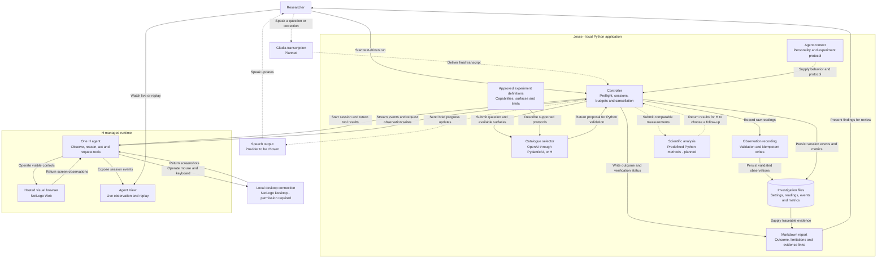

# Jesse

Status: bounded NetLogo web/desktop execution, observation recording, rate analysis and question-based catalogue routing are implemented. OpenAI/PydanticAI and H selection backends have passed live routing checks. Scientific replay acceptance and a full analysis-driven follow-up remain open; native interaction proof is still pending. Remaining product choices apply to later slices.

Team constraints: three people, 24 hours until submission as of planning, with work expected to start in 8–10 hours. Plan around eight focused implementation hours.

For team task allocation and milestone handoffs, read [the hackathon work plan](docs/HACKATHON_PLAN.md) and its proposed contracts. For NetLogo execution, maintain [the operating guide](src/jesse/experiments/netlogo/protocol.md) and [shared agent behavior](src/jesse/instructions.md), which the controller loads into H's prompt. Later gates and optional multi-provider review in the work plan remain proposals; the accepted single-agent MVP still applies. This file is the canonical decision record.

## Product

Jesse is an autonomous research technician for software-based experimental investigations. A research planner selects a suitable protocol and surface from an approved catalogue. An H computer-use agent executes the experiment through its interface. The target workflow analyzes measurements, investigates discrepancies and produces a traceable scientific Markdown report.

An unknown experiment is an unknown sample or unanswered question within supported protocols and simulations. The agent may adapt measurements and move between supported activities. Findings describe the configured simulator and its assumptions.

## Demo scenarios and related tools

Maintain three bounded scenarios. Coolant is the preferred public-facing story; NetLogo is the first engineering test. Each simulator remains unverified until H demonstrates its required GUI interactions.

| Scenario | Researcher prompt | Tool | Evidence and completion |
| --- | --- | --- | --- |
| Test a new coolant | Can this coolant absorb more heat than the reference coolant? | ChemCollective coolant activity | Record masses, temperatures, thermal assumptions and repeat measurements; calculate specific heat capacity and compare with the supplied reference. |
| Find the production bottleneck | Does adding more ingredient always make this reaction faster? | NetLogo Desktop: Enzyme Kinetics | Hold reaction constants fixed, vary substrate quantity, record rates over consistent intervals and check for a plateau. Extend with matched inhibitor trials. |
| Investigate a sliding object | How steep must this ramp be before the object starts sliding? | Algodoo with a prepared ramp scene | Hold object and surface settings fixed, repeat angle trials, bracket the sliding threshold and compare with the friction model. |

Explain substrate as the ingredient, enzyme as the processing machine, and inhibitor as something that interferes with processing. Measure reaction rate rather than conflating final product quantity with speed. NetLogo's inhibitor model is irreversible; report that limitation. Findings concern the simulator, not a physical laboratory validation.

Choose tools by scientific fit. These are separate investigations; do not force unrelated simulators into one experimental chain. Use Python for analysis and scientific Markdown for outputs in all three scenarios.

## First implementation: NetLogo desktop feasibility

The user also authorized testing NetLogo Web and comparing interaction performance with desktop. Select the surface explicitly; use the same model/protocol and record timing, step/cost metrics when available, settings and evidence. Web uses H's visual browser; desktop uses the local connection. Changing surface does not change the scientific acceptance criteria. Additional stories and models remain proposals.

Core implementation now includes a bounded NetLogo rate-comparison tool and `jesse-analyze` for saved runs. It validates comparable conditions, preserves raw observations, writes separate derived artifacts and suggests checks or repeats. It does not execute follow-ups or establish saturation. The full scientific gate still requires an agreed protocol, calibrated budget, evidence verification and an observed analysis-driven follow-up. Track remaining work in the [demo readiness checklist](docs/HACKATHON_PLAN.md#demo-readiness-checklist).

The linked model version 7.0.4 has now been inspected to define the displayed V: it is a free-substrate depletion proxy, includes substrate binding and is calculated before tick increment. Its source-derived units are substrate molecules/model tick. Supply the [measurement definition](src/jesse/experiments/netlogo/measurement.md) with the protocol; do not describe V as a direct instantaneous product-formation rate. Existing raw observations retain their original unit labels and verification status.

The second live web test exercised recording → Python analysis → report in one H session. The analysis declined comparison because the recorded rate units were unknown. Resolving the documented rate definition and units remains required; this test does not complete the full scientific gate.

Create a repository-local Python environment and one entry point using the hosted H Agents API with a local desktop connection and HAI_API_KEY supplied through the environment. Use screen observations, mouse and keyboard; simulator scripting and headless execution are outside this test.

H opens the bundled Enzyme Kinetics model, inspects settings, sets a nonzero catalytic rate (the documented default Kr is zero), enables bounded runs, runs one experiment and reads a result. Then repeat with a different substrate quantity while keeping other settings fixed. Record settings and actual observations without requiring a predetermined numerical outcome.

Save session identifier, Agent View URL, evidence references and a short Markdown outcome in ignored run files. Limit each test session to ten minutes. Missing credentials, permissions or unreadable results produce a blocked outcome; never invent readings. macOS desktop permission prompts require user interaction.

Completion: H visibly changes a native application control, runs the simulation, reads a result and records evidence corresponding to the settings. Text input comes first; voice, automated catalogue selection and full experimental analysis follow after desktop feasibility is established.

Sources: https://ccl.northwestern.edu/netlogo/models/EnzymeKinetics ; https://chemcollective.org/activities/info/92 ; https://www.algodoo.com/what-is-it/

Retain five stories: Result Detective, Protocol Reproducer, Hands-Free Technician, Adaptive Experimenter, and Experiment Handoff. Prioritize Result Detective.

## Python and H responsibilities

Q10 evolved with the user's question-routing requirement: retain one H computer-use operator and the lightweight Python controller, and add a replaceable catalogue-selection step before execution. The default selector uses PydanticAI with OpenAI; an explicit H tool-only selector is available through `--planner h`. These are alternative backends, not simultaneous planners. The full autonomous research-manager loop remains future work.

The selector returns a typed proposal; Python checks the registered protocol, actual surface availability and the researcher's explicit surface preference before launching H. The model cannot choose an arbitrary executor or expand the two-trial protocol. The controller manages sessions, executes custom tools, validates records, persists state and enforces a shared selection/execution budget. H chooses GUI actions. H's runtime manages the observation, model, action and tool loop; the SDK executes custom tools in our application while processing the session.

Expose tools for inspecting the approved application catalogue, recording observations, running predefined analyses, and assembling reports. Supply bounded protocols and assumptions directly in the investigation context. RAG, vector search, corpus backfill and retrieval of earlier investigations are outside the product scope.

Operate the selected approved simulator through its browser or native desktop interface. Associate observed readings with settings, units and supporting screenshots or session events. Preserve raw measurements separately from derived results.

Use hosted H sessions and retain agent_view_url for live viewing and replay in H Agent View. Keep one backend executor for custom tools; additional observers remain read-only. The backend must remain running while tool execution is needed.

Gladia supplies voice transcription. The voice preview streams microphone audio to Gladia, groups final utterances into silence-delimited researcher turns, and prints requests without sending them to H. It does not yet maintain a conversation with H. Spoken responses require a separate speech-output implementation. Devin and Linkup are outside the MVP.

## H harness and extension boundaries

H's harness is the runtime that connects screen observations, model decisions, GUI actions and tool results. Holo is the model used by that runtime. Public documentation describes H's own runtime; it does not identify a third-party orchestration framework underlying the hosted service.

For the MVP, use the managed Agents API and its extension points: agent instructions, model selection, reasoning effort, skills, custom Python tools, browser or desktop environments, and structured output schemas. We configure this runtime rather than patch its hosted internals. Implement Jesse's experimental behavior through instructions, application selection, observation recording, analysis and report tools.

Local execution is a separate option. Client.local() runs H's supplied runtime on our machine and can use a hosted or self-hosted Holo model. Running a downloaded runtime locally does not establish that its internals are available to edit. Local mode has different capabilities from hosted sessions; verify observability and required features before changing execution mode.

For complete control of the loop, the Models API supports implementing our own observation handling, action execution, tool dispatch, memory management, retries and stopping rules. Consider this only after documenting a requirement that the managed extension points cannot satisfy.

The public HoloDesktop CLI repository now installs the CLI distributed with the hai-agents SDK. Its open-source license is not evidence that the entire hosted harness is open source. Treat client code, runtime implementation and model weights as distinct layers with their own capabilities and licenses.

## Architecture

Jesse has one local Python controller, a replaceable protocol selector and one hosted H computer-use operator. Python owns session lifecycle, budgets, validated records and artifacts; H owns GUI actions. The selector uses either OpenAI through PydanticAI or a separate H tool-only planning session. Gladia is the planned speech-input adapter. Desktop and web are alternative execution surfaces for a selected experiment.

Solid connections show implemented paths; dashed connections show planned capabilities. The native adapter is implemented but still awaits interaction proof. Catalogue selection is implemented for one bounded protocol; other applications and scientific inference remain future work.

Extensibility lives in experiment definitions: supported question, application/model, interaction surface, operating protocol, measurement rules, assumptions, analyzer and completion criteria. A new NetLogo model reuses the runtime and surface adapters; another application may require an additional adapter and always needs its own interaction proof. Traffic Grid, Fire and the ChemCollective coolant activity are proposed stories, not implemented catalogue entries.

The scientific loop is plan → measure → analyze → verify or adapt → report. The current feasibility runner covers GUI execution, recording, a bounded Python rate comparison and a preliminary report; full scientific inference and autonomous follow-up remain planned. A completed API turn is separate from a supported scientific conclusion. Outputs may be supported, inconclusive or blocked; current runs remain inconclusive pending evidence review, or blocked when a required capability is missing.

Keep one desktop operator and one custom-tool executor. Additional agent providers or a read-only reviewer remain optional future extensions. Agent View observes execution; it does not replace the controller or execute custom tools.

## Application catalogue and investigation records

Maintain a small explicit catalogue of approved tools. Each entry specifies scientific questions supported, available models or activities, launch location, browser or desktop environment, controllable parameters, observable outputs, assumptions, and tested interaction status. Candidate entries: ChemCollective, NetLogo and Algodoo. Inclusion is a proposal until its required GUI interactions have been demonstrated with H.

`src/jesse/selecting/domain.py` now registers the Enzyme Kinetics feasibility protocol. `jesse "question"` selects and executes it; `--catalogue` lists capabilities and `--plan-only` routes without GUI execution. Only registered executors are dispatched. Unsupported questions and unavailable requested surfaces produce blocked reports. The direct `jesse-netlogo` command remains available without a selector API call. Anthropic credentials may be configured locally, but no Anthropic adapter is implemented.

Select the application that supports the requested measurement and explain the choice briefly. Use another application only when it contributes a relevant experimental or analysis capability. Shared subject matter alone does not make results from different models comparable. Unsupported questions produce a blocked outcome with the missing capability identified.

Persist investigation-local settings, raw readings, units, screenshots, hypotheses, analysis and conclusions as ordinary files with stable run and step identifiers. Preserve original observations and distinguish derived values. Make retried writes idempotent. Reports link to their evidence; later investigations do not automatically retrieve or learn from these files.

## Autonomy and completion

Start each investigation with an evidence checklist and execution budget. Permit measurement repeats, configuration checks and adaptations within that budget.

Return one of three outcomes: supported conclusion, inconclusive, or blocked. Completion requires protocol-specific observations, checked units and conditions, and a verification measurement or repeat where required.

Budget exhaustion produces an inconclusive report with recorded progress. An unresolved ambiguity or unavailable required action produces a blocked result and a specific request. Ask before expanding the agreed scope or budget.

Calibrate numerical limits after the interaction feasibility exercise and settle them before implementing the full autonomous loop.

## Personality and artifacts

Conversation: a calm, concise lab colleague. Announce the next meaningful action, report material findings, and state uncertainty directly. Example: “The estimates disagree. I will check the experimental conditions before repeating the measurement.”

Reports: precise scientific language separating method, observations, analysis, interpretation and limitations.

Produce one primary Markdown artifact per investigation, with KaTeX-compatible mathematics, tables, citations and simple Mermaid TD/LR diagrams where useful. Store supporting data, plots and analysis artifacts alongside it and link the evidence. PDF and XLSX output are outside the current MVP.

The report includes the question, protocol, assumptions, observations, analysis, verification, conclusion, limitations and evidence links. Inconclusive investigations still produce reports.

Working language and speech-output approach remain open decisions.

## Construction sequence

1. Settle scope and evidence criteria. Done when the user confirms the demo question, approved application catalogue, interaction surfaces and remaining design choices.
2. Prove H interaction. Test the chosen model's controls on its actual browser or desktop surface. Done when H changes a parameter, runs the simulation, captures a result and supporting evidence, and exposes Agent View. Manually opening the application is not this proof.
3. Establish application selection and records. Done when a supported question selects a suitable catalogue entry, an unsupported question is blocked, and measurements persist with settings, units and evidence links.
4. Build a vertical experiment. Done when observed measurements reach a predefined Python analyzer and its results drive one documented follow-up experiment.
5. Add diagnosis and recovery. Done when the agent responds to a deliberate discrepancy or failed interaction, repeats a relevant measurement, and preserves original evidence within the run budget.
6. Add voice. Done when a spoken correction changes the active investigation and the selected speech output gives a brief update.
7. Produce the artifact and demo. Done when Markdown math and diagrams render in the chosen viewing surface, evidence links resolve, and supported, inconclusive and blocked outcomes have been exercised.

## Domain code: vertical slices

Use uv with pyproject.toml for Python packaging and dependency management. Keep .env.example as the credential template; load local secrets through uv run --env-file .env. Keep .env ignored. Organize each feature under src/jesse by domain/use case. Domain and application logic depend on narrow protocols; SDK and persistence adapters implement those boundaries. Compose them at the feature entry point.

Organize domain code around use cases, such as selecting an application, recording an observation, analyzing measurements, or producing a report. Co-locate each slice's application logic, domain rules, input/output contracts, and relevant tests. Keep provider and persistence integrations behind narrow interfaces; share infrastructure only when multiple slices actually need it.

Build each slice end to end through its entry point, domain behavior, required integrations, persistence, and observable result before expanding to another use case. A slice is complete when its acceptance criteria are demonstrated through the real application path. Prefer a small working scientific workflow over completing horizontal technical layers separately.

## Agent working instructions

Fetch current API documentation before library or service integration. Use Context7 resolution and queries when relevant documentation is indexed; otherwise consult official documentation.

The user authorizes regular GitHub synchronization. Commit and push tested, runnable checkpoints, report the branch and commit, and retain credentials and ignored run artifacts locally.

Use this file as the canonical project decision record, including its architecture diagram. AGENTS.md is the entry-point pointer to this document.

## Open decisions

- Confirm the primary demo question and the small catalogue of supported applications and models.
- Confirm a thin interaction interface with H Agent View as the execution viewer.
- Choose working language and speech-output implementation.
- Calibrate numerical run budgets after the feasibility exercise.
- Confirm shared understanding before implementation.

## Resources

PDF documentation is stored in docs/resources/. Coupon and credit-benefit handouts are excluded.

- Coolant activity: https://chemcollective.org/vlab/92
- Density activity: https://chemcollective.org/activities/vlab/69
- H custom tools: https://hub.hcompany.ai/agents-api/custom-tools
- H Agent View: https://hub.hcompany.ai/agents-api/observe-and-steer
- H agent configuration: https://hub.hcompany.ai/agents-api/agents/overview
- H local runtime: https://hub.hcompany.ai/agents-api/local-runtime
- H custom model loop: https://hub.hcompany.ai/models-api/build-an-agent/function-calling
- HoloDesktop CLI source: https://github.com/hcompai/holo-desktop-cli
- H setup: [getting-started guide](<docs/resources/H Company - Get Started with Agents API.pdf>)
- H references: [technical resources](docs/resources/H_Company_Agents_API_Technical_Documentation.pdf)
- Gladia references: [technical resources](docs/resources/Resources_Gladia_Technical_Documentation.pdf)
- Linkup references, outside the current MVP: [technical resources](docs/resources/Resources_Linkup_Technical_Documentation.pdf)
