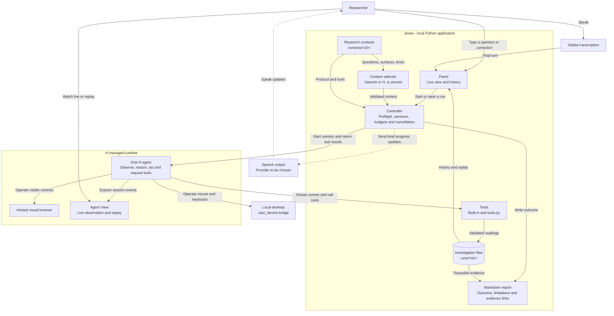

Jesse is a lab assistant, a research intern (“stagiaire”), that uses computer use to run experiments in web and desktop scientific software.

You ask a question. Jesse picks a research context, an H agent operates the lab software, Python records each reading, and Jesse writes an evidence-linked report.

## Try it

Requires [uv](https://docs.astral.sh/uv/) and an H API key.

```sh
uv sync
cp .env.example .env  # Only if .env does not already exist.
# Set HAI_API_KEY in .env. Add OPENAI_API_KEY for automatic context selection, GLADIA_API_KEY for voice.
uv run --env-file .env jesse-ui --context chemcollective-coolant
```

Open http://127.0.0.1:8765, then type or speak a question:

> Compare this new coolant with the reference, run the experiment, verify your measurements, and explain which absorbs more heat per gram for the same temperature rise.

The panel shows the lab screen, H's actions, the plan and each measurement. Send a correction while the session is open. The report opens as soon as it is ready, including while the session remains available for follow-ups. The report combines checked measurements with the agent's interpretation; scientific acceptance still requires replay review.

`--context` sends every question to one context and skips the selector, so the demo needs no OpenAI key. Without it, Jesse asks the selector to choose among all contexts and blocks questions that none of them supports.

### Two demo contexts

The local launcher installs dependencies, builds the panel and opens it in your browser. Run one of these from the repository root:

```sh
# Coolant: ChemCollective in H's hosted browser
./launch_local.sh chemcollective-coolant web

# Forest fire: the installed NetLogo application on your Mac
./launch_local.sh netlogo-fire desktop
```

For Fire, ask:

> How does tree density change how much of a forest burns? Compare 55% and 70% density and repeat both conditions.

Fire runs four fresh trials within a ten-minute budget and compares the displayed burned percentages. The desktop context points to NetLogo 7.0.4 under `/Applications`; adjust `contexts/netlogo-fire/context.toml` if installed elsewhere. Enable the desktop permissions described below. Both Fire surfaces remain unverified until their interaction evidence is reviewed.

To use NetLogo Web instead, run `./launch_local.sh netlogo-fire web`. To keep two panels open, give the second one another port: `PORT=8766 ./launch_local.sh netlogo-fire desktop`. Each desktop investigation needs exclusive control of your mouse and keyboard.

If dependencies and the UI build are already present, launch directly with `uv run --env-file .env jesse-ui --context netlogo-fire --surface desktop`. Stop the current panel with Ctrl+C before reusing its port.

## Docker Compose

With the existing `.env` in the repository root:

```sh
docker compose up --build -d
docker compose ps
```

Open http://localhost:8080. The frontend serves the React assets and proxies the HTML and API to the backend, which injects its CSRF token. The backend loads both research contexts and uses hosted web surfaces. Investigation files persist in the `jesse-runs` volume. Use `docker compose down` to stop the app while keeping that volume.

The image excludes `.env`, local runs and credentials. Containers use `.env` only at runtime. Native NetLogo desktop control stays in the local launcher. The current microphone implementation captures on the backend machine; browser microphone capture is a separate integration, so use text input in the containers.

The `Publish images` GitHub Actions workflow publishes both amd64 images to GHCR with immutable `sha-<full commit>` tags, using GitHub's built-in token. Its `deploy` job then sets both tags in `helm/jesse/values.yaml` of the cluster repository through the `dirdr-ci` GitHub App (`DIRDR_CI_APP_ID` and `DIRDR_CI_APP_PEM` secrets), and ArgoCD rolls the update out.

For a reverse proxy, configure `JESSE_ALLOWED_HOSTS` with the public hostname and `JESSE_PUBLIC_URL` with its HTTPS origin. The default local launcher still binds to loopback. `/healthz` provides the container health check.

Kubernetes deployment files live in the cluster repository under `helm/jesse` and `apps/jesse.yaml`. The `jesse` namespace contains separate frontend and backend Deployments, a persistent run volume, the `jesse-env` Secret imported from the current `.env`, and a Traefik ingress for `jesse.adrienpelfresne.com`. ArgoCD manages the deployment with automatic sync and self-healing. The user requested public access without a login. Secret values are managed with kubectl and kept out of Git.

## Past investigations

The left sidebar lists every investigation in `runs/`, newest first. Click one to replay its screens, measurements and report. Use `--runs <folder>` to keep a separate history, for example one per demo.

## Voice

Set `GLADIA_API_KEY` in `.env` and press the microphone button. The first spoken turn starts an investigation; later turns reach the running session as corrections. macOS asks the terminal for microphone access. See [live voice setup](docs/LIVE_VOICE.md) for the noise gate and the terminal preview.

## Add a research context

A research context is one folder in `contexts/`. Jesse loads every folder at startup; names starting with `_` are skipped.

```sh
cp -r contexts/_template contexts/my-lab
# Edit context.toml and protocol.md, then check that Jesse reads it:
uv run jesse --catalogue
uv run --env-file .env jesse-ui --context my-lab
```

| File | Purpose |
| --- | --- |
| `context.toml` | What the lab answers, where it runs, which tools H gets, and its limits |
| `protocol.md` | Step-by-step instructions H follows inside the lab |
| `tools.py` | Optional Python tools for this lab, such as a calculation |

[`contexts/chemcollective-coolant`](contexts/chemcollective-coolant) and [`contexts/netlogo-fire`](contexts/netlogo-fire) are complete examples.

### context.toml

```toml
id = "my-lab"                       # lowercase letters, digits, hyphens
title = "What this lab measures"
application = "Name of the software"
questions = ["A question this lab answers."]
unsupported = ["A question it must refuse."]
assumptions = ["Simulator findings only"]
sources = ["https://example.org/docs"]
tools = ["publish_update", "acknowledge_researcher_message", "record_observation"]

[surfaces.web]                      # H's hosted browser
start_url = "https://example.org/lab"

[surfaces.desktop]                  # your own computer
app_path = "/Applications/MyLab.app"

[limits]
budget_seconds = 600                # at most 600
max_steps = 110
max_trials = 2
```

The selector reads `questions`, `unsupported` and `status` to decide whether a question fits. Write them as a researcher would ask.

### Surfaces: web and desktop

Declare one or both.

- **Web**: H opens `start_url` in a hosted browser. Your mouse stays free. Nothing is installed locally.
- **Desktop**: H controls your Mac through the SDK's local bridge (`host = "user_device"`). Install the application first. In **System Settings → Privacy & Security**, enable **Screen & System Audio Recording** and **Accessibility** for the terminal that runs Jesse, then restart it. Keep your hands off the mouse during the run; press **Esc** twice to stop H.

With both declared, Jesse prefers web. Force one with `--surface web` or `--surface desktop` on either `jesse` or `jesse-ui`.

### Tools

H calls tools to report progress and save readings; Python validates every call.

Built-in tools, enabled by name in `tools`:

| Tool | What H does with it |
| --- | --- |
| `publish_update` | Tells the researcher the plan, a finding, a follow-up or a blocker |
| `acknowledge_researcher_message` | Answers a correction sent from the panel or by voice |
| `record_observation` | Saves displayed values, units, raw text and evidence for one trial |

For lab-specific work, add `tools.py`. Jesse calls `tools(lab)` and gives H every function it returns. H sees each function's name, typed arguments and docstring, so write the docstring as an instruction.

```python
def tools(lab):
    def record_measurement(trial_id: str, value: float, unit: str, raw_reading: str, evidence: list[str]) -> dict:
        """Save one displayed value with its unit, raw text and screenshot evidence."""
        return lab.record(trial_id, {"value": value, "unit": unit, "raw_reading": raw_reading, "evidence": evidence},
                          fields={"Value": f"{value:g} {unit}"}, summary=f"Saved {trial_id}: {value:g} {unit}.")
    return [record_measurement]


def report(lab):
    return "## Summary\n\n" + f"{len(lab.observations())} trial(s) recorded."
```

`lab.record` saves the raw reading once, rejects conflicting retries, enforces `max_trials`, and stores any `analysis` dictionary separately from the raw reading. `fields` and `result` appear in the panel's measurement list. The optional `report(lab)` adds a section to `report.md`. At the end of a run, Jesse decides the outcome automatically: an OpenAI model reads the question, the context's `completion` criteria and assumptions, the recorded trials, their Python analyses and the agent's report, and returns `supported_conclusion` or `inconclusive` with a short reason (saved in `verdict.json`). Python analyses outrank the agent's claims, a supported conclusion must cite recorded trials, a run without measurements is `blocked`, and replay review stays pending. Write clear `completion` criteria in `context.toml`: they are what the verdict checks. `tools.py` runs as ordinary Python on your machine, so treat it like any other code you install.

## Command line

```sh
uv run jesse --catalogue                                       # list contexts
uv run --env-file .env jesse "question" --context my-lab       # run one context
uv run --env-file .env jesse "question" --plan-only            # choose a context, run nothing
uv run --env-file .env jesse "question" --planner h            # choose with H instead of OpenAI
```

Each run writes `runs/<id>/`: the question, selection, H events, raw observations, analyses and `report.md`. A context's checked completion criteria can produce a **supported conclusion**, with replay review still pending. Fire remains **inconclusive** pending review; **blocked** means a required capability or reading was missing.

## Architecture

Python owns sessions, budgets, tools and records. One hosted H agent operates the lab. Solid arrows show implemented paths; dashed arrows show planned ones.



Findings describe the configured simulator and its assumptions, not a physical laboratory.
