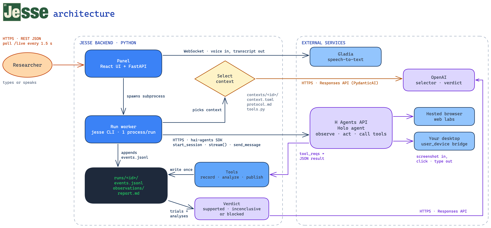

# Jesse

Jesse runs experiments in scientific software through an H computer-use agent, records measurements, and produces a report. Research notes in [research/](research/) tell it which tools to use and how to report results.

## Architecture



[Edit the diagram in Excalidraw](docs/architecture.excalidraw).

## Run locally

Install [uv](https://docs.astral.sh/uv/getting-started/installation/), [Node.js](https://nodejs.org/) 22 or newer, and [pnpm](https://pnpm.io/installation) 10.26 or newer. uv installs Python 3.13 automatically.

From the project folder:

```sh
cp .env.example .env
```

Set these keys in `.env`:

- `HAI_API_KEY`: required to run the H agent.
- `OPENAI_KEY`: enables the report's evidence-based verdict and writes spoken updates. Without it, results cannot receive a supported conclusion.
- `FISH_API_KEY`: enables Jesse Pinkman's voice through Fish Audio; requires `OPENAI_KEY` too. Optional for text-only use.
- `GLADIA_API_KEY`: enables microphone transcription. The panel captures your browser's microphone over HTTPS or localhost; allow microphone access when prompted. The deployed backend does not need an audio device.

Start the panel:

```sh
./launch_local.sh
```

The launcher installs dependencies, builds the UI, and opens [http://127.0.0.1:8765](http://127.0.0.1:8765). Keep the terminal running; press **Ctrl+C** to stop.

Enter a question, for example:

> Is the period of a pendulum independent of its mass? Use PhET Pendulum Lab, keep length, gravity, release angle, and friction fixed, and repeat measurements at different masses.

Watch the agent, send corrections, or select a previous action to replay it. **Back to live** returns to the current view. An inconclusive report offers an editable prompt for a new experiment. Reports and measurements stay in `runs/<id>/`.

If the port is occupied, use `PORT=8766 ./launch_local.sh` and open `http://127.0.0.1:8766`.

## Try desktop control with NetLogo (macOS)

Install NetLogo at the path listed in [research/forest-fire.md](research/forest-fire.md), or update that note to match your installation. Grant your terminal **Screen Recording** and **Accessibility** permissions in **System Settings → Privacy & Security**, then restart the terminal.

```sh
./launch_local.sh desktop
```

In the panel, enter:

> Use NetLogo desktop's Fire model. Compare 55% and 70% tree density, run two fresh forests at each density, and report the percent burned, mean, and range.

H controls your mouse and keyboard. Keep your hands off the controls during the run; press **Esc twice** to stop H. To keep the browser-mode panel running too, launch desktop mode with `PORT=8766 ./launch_local.sh desktop`.

## Optional

- **Voice input:** set `GLADIA_API_KEY` and allow microphone access.
- **Spoken replies:** set `OPENAI_KEY` and `FISH_API_KEY`, restart Jesse, and select **Jesse Pinkman** before starting an experiment. Enable the speaker button in the panel. Select **Lab colleague** to use OpenAI speech with `OPENAI_KEY` alone.
- **Your own experiments:** copy [research/_template.md](research/_template.md) to a new Markdown file in `research/` and describe your tools, controls, and required results. Jesse reads all notes before each run.

See [AGENT.md](AGENT.md) for architecture and project decisions.
