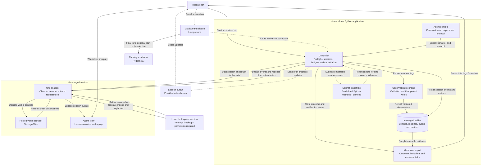

Jesse is a personal lab assistant. a research intern (“stagiaire”) that uses computer use to conduct experiments in web and desktop scientific software and work with Python, Excel, and the tools that you use as a researcher.

## Try it

Requires [uv](https://docs.astral.sh/uv/) and an H API key.

```sh
uv sync
cp .env.example .env  # Only if .env does not already exist.
# Set HAI_API_KEY in .env.
uv run --env-file .env jesse-netlogo --surface web --timeout 300
```

Open the printed **Agent View URL** to watch live. The current test runs NetLogo Enzyme Kinetics; evidence and reports are saved under `runs/`. See [run instructions](DESKTOP_TEST.md) for desktop setup and permissions.

To preview spoken questions through Gladia and the Pydantic AI selector without
starting H, see [live voice setup](docs/LIVE_VOICE.md).

## Architecture

Python manages sessions, budgets, records, and reports. One hosted H agent operates the selected interface. Solid arrows show implemented paths; dashed arrows show planned capabilities. Native interaction still requires permission and verification.



## Example scenarios

Proposed experiments to test next; these are not selectable in the current runner.

| Scenario                | Research question                                                | Software and measurements                                                                                                                                              |
| ----------------------- | ---------------------------------------------------------------- | ---------------------------------------------------------------------------------------------------------------------------------------------------------------------- |
| Fix city congestion     | Which traffic-light timing reduces waiting without adding roads? | [NetLogo Traffic Grid](https://ccl.northwestern.edu/netlogo/models/TrafficGrid): compare waiting time and speed at fixed traffic demand.                               |
| Investigate fire spread | How does forest density affect the spread of a fire?             | [NetLogo Fire](https://ccl.northwestern.edu/netlogo/models/Fire): vary density and repeat trials to compare the fraction burned.                                       |
| Test a new coolant      | Does this coolant absorb more heat than the reference?           | [ChemCollective coolant activity](https://chemcollective.org/activities/info/92): record masses and temperatures, calculate heat capacity, and repeat the measurement. |

Each scenario needs its own protocol and GUI interaction test. Findings describe the simulator and its assumptions.
